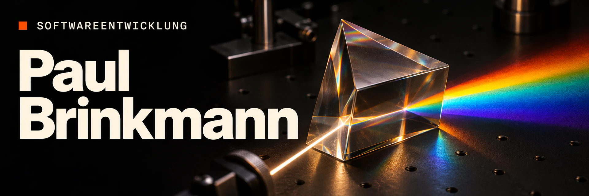
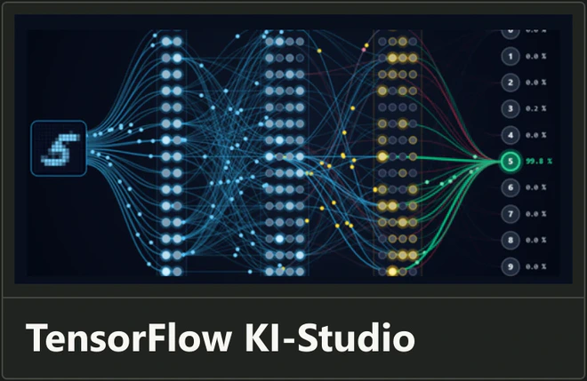
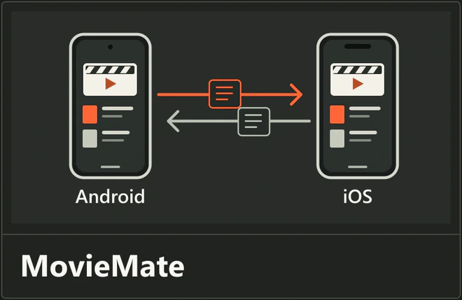
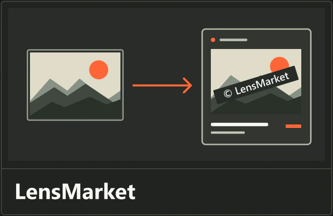

<h1>
  <a href="https://paulbrinkmann.de/#prism-canvas">
    <picture>
      <source media="(max-width: 640px)" srcset="./assets/prisma-mobile.webp">
      
    </picture>
  </a>
</h1>

Wo berührt ein medizinischer Führungsdraht die Gefäßwand? Für meine Bachelorarbeit in Heidelberg habe ich die Physik-Engine Bullet in eine Unity-Simulation eingebaut, um genau diese Kontaktpunkte zu finden.

Heute studiere ich **Angewandte Informatik im Master an der FH Erfurt** und arbeite als **Werkstudent in der Softwareentwicklung bei LASOS Lasertechnik** in Jena.

[Mit dem Lichtstrahl experimentieren ↗](https://paulbrinkmann.de/#prism-canvas) · [Mein Werdegang](https://paulbrinkmann.de/#werdegang) · [LinkedIn](https://www.linkedin.com/in/paul-brinkmann/)

## Auf dem Lichttisch

  
  
  

### [TensorFlow KI-Studio](https://github.com/Paul1708/TensorFlow-KI-Studio)

Zeichne eine **5** und fahre mit der Maus über einen Filter. Du siehst, auf welche Striche er reagiert. Ein Klick auf das Ausgabeneuron zeigt dir, welche Neuronen zur Vorhersage beigetragen haben. Das funktioniert komplett offline. [Schicht für Schicht durch den Python-Code ↗](https://github.com/Paul1708/TensorFlow-KI-Studio/blob/main/src/ki_studio/core/engine.py#L363-L418)

### [MovieMate](https://github.com/Paul1708/MovieMate)

Du löschst unterwegs einen Film aus deiner Sammlung. Auf dem Tablet ist er noch da. Für solche Fälle merkt sich unsere Android- und iOS-App auch Löschungen. Wenn du den Abgleich über Google Drive einschaltest, führt der gemeinsame Kotlin-Kern beide Stände zusammen. [Die Konfliktregel in Kotlin lesen ↗](https://github.com/Paul1708/MovieMate/blob/main/shared/src/commonMain/kotlin/de/fh/erfurt/moviemate/movies/data/sync/SyncSnapshotMerger.kt#L28-L63)

### [LensMarket](https://github.com/Paul1708/lensmarket)

Auf unserem Fotomarktplatz bekommt jedes hochgeladene Bild ein Wasserzeichen. Sobald es fertig ist, meldet der Bilddienst das per Ereignis. Der Inseratsdienst hängt das Bild ans Angebot – auch wenn dieselbe Nachricht zweimal eintrifft, erscheint es nur einmal. [Dem Wasserzeichen-Ereignis bis ins Inserat folgen ↗](https://github.com/Paul1708/lensmarket/blob/main/listing-service/src/main/kotlin/lensmarket/listing/events/ImageWatermarkedEventConsumer.kt#L11-L43)

## Ein Sortierexperiment

Die Reihe beginnt mit **5 · 3 · 8 · 2 · 6**. Bubble Sort vergleicht von links nach rechts immer zwei Nachbarn und tauscht sie, wenn der größere Wert links steht. Wie sieht die Reihe nach einem Durchlauf aus?

Den ersten Durchlauf ansehen

**3 · 5 · 2 · 6 · 8.** Die 8 steht schon an ihrem endgültigen Platz. Die 2 hat es erst eine Position nach links geschafft.

[AlgoViz im Browser ausprobieren ↗](https://paulbrinkmann.de/#demo-open) · [Zum JavaScript](https://github.com/Paul1708/AlgoViz/blob/main/script.js)

## Zwei Spiele in C#

- **[IFP Tanks](https://github.com/Paul1708/IFP_Tanks)** · Ein Godot-Spiel mit 20 Pixelart-Leveln. Einer der Gegner verschwindet mitten im Spiel aus dem Blickfeld. [So funktioniert seine Tarnung.](https://github.com/Paul1708/IFP_Tanks/blob/develop/Code/Scripts/Enemies/InvisBehaviour.cs)
- **[3D Roll-a-Ball](https://github.com/Paul1708/3DRollABall)** · Sieben Würfel einsammeln, während ein Gegner die Kugel verfolgt. Mit diesem kleinen Unity-Spiel habe ich ausprobiert, wie sich Kräfte und Kollisionen beim Steuern anfühlen.
