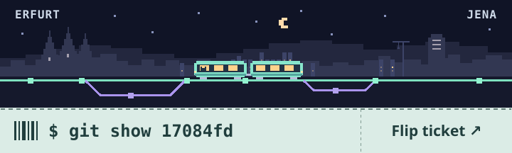

### Hi, I’m Paul.

Master’s student in Applied Computer Science in Erfurt and part-time Software Developer at LASOS in Jena. 
Writing production code by day, and debugging everything else on the Erfurt–Jena commute by night.

&nbsp;
&nbsp;

 

The towers between Erfurt and Jena grow with my commits: one per active week, one lit window per day.

